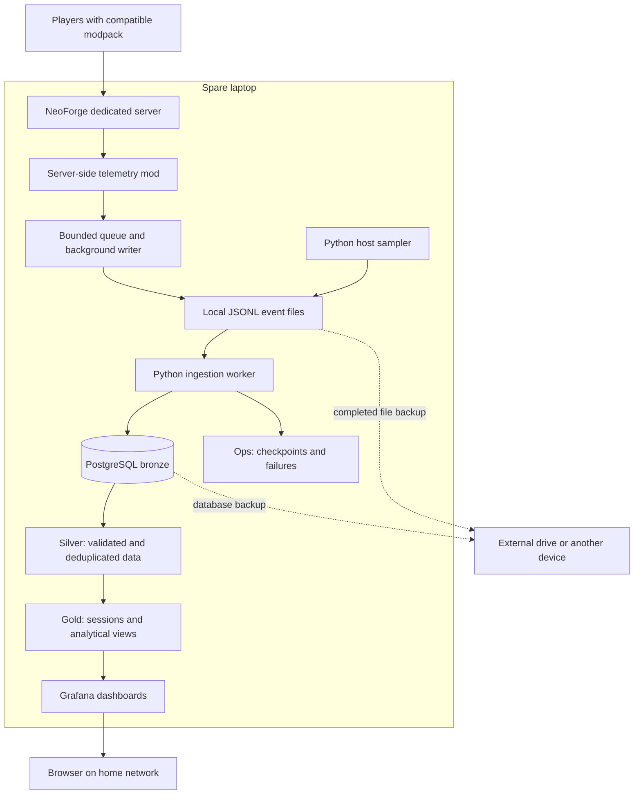

# Minecraft Data Engineering Project

A local data engineering portfolio project that turns gameplay and server telemetry from a self-hosted, modded Minecraft server into useful analytics.

**Status: planning.** This repository currently contains documentation. The server, telemetry collector, pipeline, database migrations, and dashboards have not been implemented.

## Project goals

- Host a NeoForge dedicated Minecraft server on a spare laptop.
- Collect player events and periodic server health measurements without blocking gameplay.
- Ingest structured local event files with Python.
- Use PostgreSQL with bronze, silver, and gold medallion layers.
- Explore player activity and server performance through Grafana.
- Demonstrate validation, duplicate-safe replay, recovery, and local backups.
- Keep the runtime local, with no required cloud services.

## Planned stack

| Component | Technology | Responsibility |
| --- | --- | --- |
| Game server | Minecraft Java Edition + NeoForge | Dedicated server and compatible gameplay mods |
| Telemetry collector | Custom server-side Java mod | Observe events and write structured records asynchronously |
| Local event storage | Rotated JSONL files | Buffer ingestion and retain replayable source records |
| Pipeline | Python | Ingest files, validate records, run SQL transformations, and sample host health |
| Database | PostgreSQL | Persist bronze and silver data and expose gold analytics |
| Dashboards | Grafana | Visualize gameplay, server health, and pipeline health |
| Data service deployment | Docker Compose | Manage Python, PostgreSQL, and Grafana locally |
| Backups | PostgreSQL dumps and file backups | Recover using an external drive or another personally managed device |

Exact software versions will be pinned after selecting compatible gameplay mods and checking the laptop's hardware and operating system.

## Architecture



The server-side collector writes files rather than connecting directly to PostgreSQL. Database downtime can then be buffered locally while disk space remains available. Gameplay state is captured in the appropriate server context; serialization and disk writes happen in the background.

## Planned telemetry

| Category | Initial measurements | Later extensions |
| --- | --- | --- |
| Player lifecycle | Joins, quits, server run boundaries | Deaths, respawns, dimension changes |
| Gameplay | Added after the first working slice | Block breaks and placements, crafting, selected item activity |
| Server health | Connected players and JVM heap; tick timing after version-specific verification | Garbage collection, loaded chunks, entity counts |
| Laptop health | CPU utilization, available memory, free disk | Additional diagnostics when needed |
| Pipeline health | Ingestion delay, rejected records, queue drops, write failures, file backlog | Recovery and workload comparison reports |
| Modded systems | Environment manifest and namespaced content identifiers | Machine production or energy metrics through selected mod integrations |

Gameplay event coverage will be documented and tested. Generic hooks do not necessarily capture automated machines, and cancelable events must not be mislabeled as completed actions. Client FPS, keystrokes, chat contents, and IP addresses are outside the initial scope.

## PostgreSQL medallion layers

| Schema | Purpose | Planned examples |
| --- | --- | --- |
| `bronze` | Preserve source text and ingestion metadata with minimal transformation | `event_records` |
| `silver` | Validate, type, deduplicate, and standardize records | `player_events`, `server_samples`, `host_samples`, `server_runs` |
| `gold` | Serve defined analytical grains and dashboard metrics | `player_sessions`, `daily_player_activity`, `server_health_by_minute` |
| `ops` | Track processing and failures | `file_checkpoints`, `transform_checkpoints`, `rejected_records`, `pipeline_runs` |

Bronze and silver will be persisted. Gold starts with SQL views; stored summaries are added only when measured query costs justify them. This is a PostgreSQL implementation of medallion layering, not a distributed lakehouse.

## Implementation roadmap

- [ ] **Phase 0 — Confirm the environment:** inventory hardware, choose a compatible mod set and versions, and define the telemetry contract.
- [ ] **Phase 1 — Establish the foundation:** start the dedicated server and local data services; create database migrations and roles.
- [ ] **Phase 2 — Deliver the first working slice:** collect joins/quits and basic health, ingest bronze/silver, and display a Grafana dashboard.
- [ ] **Phase 3 — Prove recovery and data quality:** test restarts, replay, malformed records, rotation, and database outages.
- [ ] **Phase 4 — Expand gameplay analytics:** add verified gameplay hooks, session models, and gold views.
- [ ] **Phase 5 — Establish local operations:** configure retention, backups, restore tests, and resource monitoring.
- [ ] **Phase 6 — Publish portfolio evidence:** document measured results, dashboard screenshots, lineage, limitations, and a reproducible demonstration.

See the [full project and implementation plan](docs/superpowers/plans/2026-10-27-local-minecraft-telemetry.md) for architecture decisions, event contracts, phase deliverables, acceptance checks, and operational policies.

## Planned repository layout

The directories below are proposed; only documentation exists today.

```text
telemetry-mod/       NeoForge Java mod and dedicated-server checks
pipeline/            Python ingestion, host sampling, and transformation worker
sql/                 Database migrations and silver/gold SQL models
dashboards/          Version-controlled Grafana dashboards and provisioning
deploy/              Compose configuration and example settings
tests/               Synthetic events and ingestion/recovery tests
docs/                Project plan, event catalog, and operating instructions
```

Server worlds, mod binaries, real player records, database files, credentials, and backups will remain outside Git. Local setup instructions will be added when the deployment exists; there is no runnable quick start yet.

## Operating assumptions

- Target dashboard freshness: within 15 seconds under the tested normal workload; this is a goal, not a measured result.
- PostgreSQL stays on the private service network; Grafana uses a read-only account for gold analytics.
- Gameplay mods may require matching client installations; the telemetry mod is intended to require no client installation.
- Durable source records can be replayed without increasing silver event counts or gold metrics.
- A single laptop is a single point of failure. In-memory and not-yet-synced data can be lost during a crash.
- Personally managed backups on a separate device are required for recovery from disk failure.

## References

- [NeoForge dedicated server installation](https://docs.neoforged.net/user/docs/server/)
- [NeoForge events](https://docs.neoforged.net/docs/concepts/events/)
- [NeoForge client/server sides](https://docs.neoforged.net/docs/concepts/sides/)
- [PostgreSQL documentation](https://www.postgresql.org/docs/current/)
- [Medallion architecture](https://learn.microsoft.com/en-us/azure/databricks/lakehouse/medallion)
- [Grafana PostgreSQL data source](https://grafana.com/docs/grafana/latest/datasources/postgres/)
- [Docker Compose](https://docs.docker.com/compose/)
