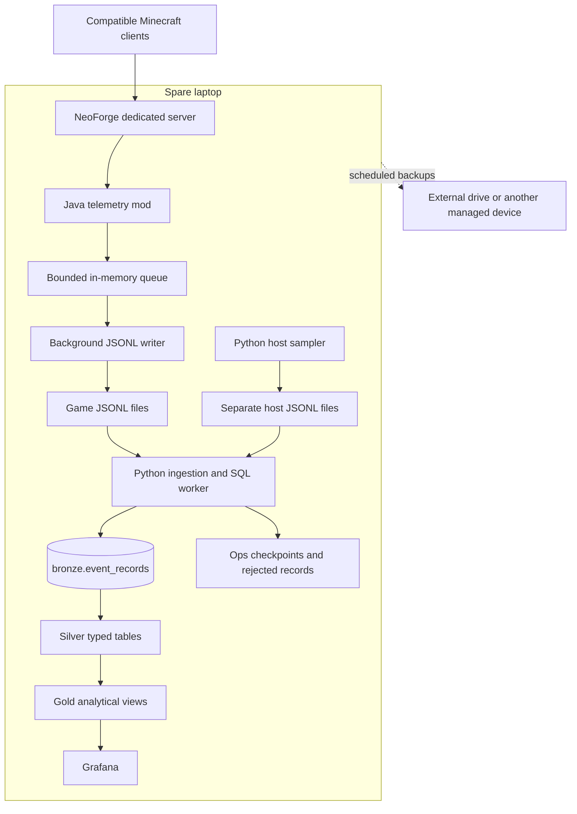

# Local Minecraft Telemetry Project and Implementation Plan

**Status:** Proposed design and phased delivery plan; no runtime implementation exists.
**Date:** October 27, 2026.
**Goal:** Operate a modded Minecraft server and a recoverable telemetry analytics pipeline on one personally managed laptop.
**Architecture:** A server-side NeoForge mod captures telemetry into local event files. Python loads PostgreSQL bronze records, transforms them into silver data, and exposes gold analytics to Grafana.
**Tech stack:** Minecraft Java Edition, NeoForge, Java, JSONL files, Python, PostgreSQL, Grafana, Docker Compose.
**Scope:** This document is the initial design and phase plan. Phase 0 resolves hardware and version choices before producing version-specific implementation tasks and exact API signatures.

## 1. Intent and success criteria

Build a portfolio project that demonstrates the whole path from a real event source to trustworthy analytics. Reliability, documented semantics, and reproducible operations matter more than adding infrastructure.

The first working slice is a player joining and leaving the server, appearing in PostgreSQL and a Grafana dashboard. The finished initial release also demonstrates replay, validation, incomplete sessions, backups, and workload measurements.

### Goals

- Run the Minecraft server and data services on the spare laptop.
- Preserve the option to install compatible NeoForge gameplay mods.
- Collect structured player, server, host, and pipeline telemetry.
- Apply medallion quality boundaries using PostgreSQL schemas.
- Keep runtime operation independent of cloud services.
- Retain enough source data to repair transformations and rebuild results.
- Publish synthetic fixtures, documented metrics, and measured results suitable for a portfolio.

### Non-goals

- A distributed or highly available deployment.
- Kafka, Spark, Kubernetes, a cloud warehouse, or an object storage service in the initial release.
- Compatibility with every mod loader or automatic collection of every mod's internals.
- Client instrumentation, continuous movement tracking, chat collection, or machine learning.
- A hard zero-loss guarantee or exactly-once capture from the game.

### Initial targets, to validate on the laptop

| Target | Acceptance approach |
| --- | --- |
| Dashboard freshness within 15 seconds at normal load | Measure event time to dashboard visibility, including refresh interval; report p50/p95 and workload |
| Duplicate-safe processing | Replay an identical fixture and confirm unchanged silver counts and gold metrics |
| Recovery from a 10-minute database outage | Continue file collection, restart ingestion, and reconcile all retained complete records |
| Understandable gameplay overhead | Compare the same workload with collection disabled/enabled; provisionally target less than 5% relative p95 tick-time increase and report absolute values |
| Recoverable local data | Restore a database backup to an isolated database and replay later retained files |

These are proposed engineering targets, not claims about current behavior. Phase 0 defines the workload using expected player count, mod set, and laptop capacity.

## 2. Decisions and alternatives

| Decision | Chosen approach | Alternative and tradeoff |
| --- | --- | --- |
| Server | NeoForge dedicated server | Paper makes plugin collection convenient but does not directly run NeoForge gameplay mods |
| Transport | Local append-only JSONL files | A broker adds independent subscriptions and managed retention, but also more services and resource use |
| Storage | PostgreSQL plus local source archives | ClickHouse/object storage are unnecessary until measured workloads justify them |
| Data organization | Bronze, silver, gold, and ops schemas | Raw/staging/marts provides similar separation; dimensional modeling can coexist inside gold |
| Hosting | One laptop | A second host improves isolation and availability but is outside the current scope |
| Transformation scheduling | One Python worker invokes SQL in short cycles | A dedicated orchestrator adds operational work without an initial requirement |
| Deployment | Native NeoForge process; Compose for data services | Containerizing the game is optional, not required for the first release |

The user selected NeoForge, Python, PostgreSQL medallion layers, Grafana, and local hosting. File transport, native game hosting, sampling intervals, and initial operating thresholds are proposals in this plan.

## 3. Physical architecture

Run the Python sampler and worker as separate service processes using the same Python codebase. Each producer owns its own files; no two processes append to the same file. PostgreSQL and Grafana use persistent volumes. The worker mounts source files read-only; an archive maintenance task owns compression and deletion.

Use health checks and restart policies for data services, but also implement database reconnect/retry in the worker. Service startup ordering does not handle every later outage. Keep game memory and CPU headroom available rather than assigning all resources to the JVM or database.

Internet access may be needed for installation, updates, and normal Minecraft authentication. No cloud data platform is required. External players need a separately planned network access method; database access is not exposed along with the game port.

## 4. Telemetry collection

### Initial and expansion event catalog

| Priority | Event/measurement | Source and interpretation |
| --- | --- | --- |
| First slice | `server_started`, `server_stopping` | Lifecycle hooks; absence of a shutdown record can indicate an unclean exit |
| First slice | `player_joined`, `player_left` | Server player lifecycle; attach a collector-generated session ID |
| First slice | `server_sample` | Every 5 seconds of elapsed time: connected players and JVM heap; tick measurements after verification |
| First slice | `host_sample` | Every 10 seconds: CPU utilization, available memory, free disk bytes |
| First slice | `collector_sample` | Queue depth, cumulative dropped records, write errors, last successful write |
| Expansion | `player_died`, `player_respawned` | Actual player lifecycle, not all entity deaths |
| Expansion | `block_broken`, `block_placed` | Only hooks with verified completion semantics; otherwise label an attempt explicitly |
| Expansion | `dimension_changed`, `item_crafted` | Verify actual supported behavior and quantities before treating as analytics facts |
| Expansion | Additional server fields | GC counter deltas, loaded chunks, entity counts, sampled only when affordable |
| Optional | Mod-specific production/energy | Targeted APIs or hooks for selected installed mods |

Sampling cadence is based on elapsed time, not an assumption that a fixed number of ticks always equals a fixed number of seconds. Avoid full world or inventory scans. Record sample window duration and missing measurements explicitly.

### Hook correctness and coverage

- Observe authoritative server behavior; never depend on client-only classes in the dedicated server.
- Copy primitive values and identifiers in the event's supported execution context. Do not send live world/entity objects to the background writer.
- Confirm hook order, cancellation, and post-action availability for the pinned version. A lowest-priority listener alone is not proof that an operation succeeded.
- Verify a representative vanilla action and a modded action. Automation or fake-player activity may differ; document uncovered behavior.
- Separate human, automated, and unknown actors when evidence supports the distinction. Do not invent a human attribution.
- The telemetry mod adds no gameplay content or required custom client messages. Verify it operates without client installation, alongside the gameplay pack's required client mods.
- Generic player event hooks do not guarantee collection of every machine's recipe, energy transfer, or output.

### Tick and host metric definitions

Measure completed server ticks over an elapsed-time window for achieved TPS, accounting for paused/idle behavior. For milliseconds per tick, use the selected version's supported server timing facility or a verified full-tick measurement. A callback's own execution time is not full server tick time. Record units, window, method, and sample count; report unavailable values as null, not zero.

Client FPS and client CPU cannot be inferred from server telemetry. JVM heap, process metrics, and whole-host memory are distinct measurements. Choose a small maintained host metrics library only if the standard library/platform cannot reliably provide the required measurements on the selected OS.

## 5. Event contract

Proposed envelope for game records:

| Field | Meaning |
| --- | --- |
| `schema_version` | Integer contract version; start with 1 |
| `event_id` | UUID generated once at capture; preserved during replay |
| `event_type` | Stable catalog name, such as `player_joined` |
| `event_time` | UTC timestamp with timezone |
| `server_id` | Stable identifier for this server installation |
| `server_run_id` | UUID generated at each server process start |
| `producer_sequence` | Increasing sequence assigned in enqueue order within this producer run |
| `environment_id` | Reference to the version/mod manifest |
| `player_id` | Nullable pseudonymous player identifier |
| `session_id` | Nullable session UUID, assigned at join and reused for that session's events |
| `payload` | Event-specific JSON object |

Host records use their own producer/run identity and sequence; they must not pretend to originate from a game process. Ingestion adds source identity, original line/byte position, ingestion timestamp, and record checksum without altering source text.

Write the environment manifest before referencing it: Minecraft version, NeoForge version, telemetry mod version, gameplay mod IDs/versions, and relevant server configuration such as view distance. The full manifest is stored once per run and referenced by events. Missing manifest references remain visible and retryable in silver processing.

Use namespaced content identifiers for blocks, items, entities, and dimensions. Do not hard-code a vanilla-only allowlist. If a shared secret is used to derive pseudonymous player IDs, keep it stable, outside Git, and in the backup policy. Pseudonyms remain linkable player data; share only synthetic or suitably anonymized portfolio examples.

## 6. File transport and durability

- The collector enqueues without waiting for disk or PostgreSQL. Queue size and maximum record size are bounded and documented in deployment configuration.
- On queue saturation, drop the incoming telemetry record, increment a cumulative counter, and emit a rate-limited operational warning. Never silently block the game thread. This means collection can lose data under pressure.
- A single background writer per producer appends UTF-8 JSON followed by a newline. Rotate on size or time using immutable source file IDs. Do not use copy-truncate rotation or reuse file identities.
- The reader processes only complete newline-terminated records. It waits for a partial active line; a truncated closed-file tail is preserved and reported as a rejected source record.
- Closed segments become eligible for compression only after ingestion acknowledges their complete contents. Preserve file identity and line numbers for replay from compressed archives.
- The writer should flush regularly and use a documented periodic disk sync policy; propose a one-second sync interval initially, then measure its overhead. A graceful stop drains the queue within a bounded timeout and closes the file.
- In-memory records and data not yet durably synced may be lost on a crash or power failure. At-least-once processing applies to retained durable source records, not every action in Minecraft.
- Before disk exhaustion, alert using both percent utilization and absolute free bytes. At a reserve threshold, stop telemetry writes and report loss rather than filling the disk shared with the world and PostgreSQL. Phase 0 sets byte limits based on measured capacity.

## 7. PostgreSQL medallion design

Use one database, proposed name `minecraft_telemetry`, with separate schemas and roles. Bronze/silver tables persist data; gold starts with ordinary views. A medallion layer is a responsibility boundary, not a requirement to copy every record three times.

### Bronze: preserve evidence

`bronze.event_records` has one row per source file line, keyed by `(producer_id, source_file_id, line_number)`. Store original text, checksum, ingestion time, and an optional parsed JSONB value. JSONB alone does not preserve original formatting or duplicate object keys; retain source text for forensic replay.

Business validation and event-ID deduplication happen downstream. Two separate source lines containing the same event remain two bronze records. Re-reading the same source position does not create another bronze row. If an existing source identity is replayed with different contents, report an integrity error rather than silently ignoring the conflict.

### Silver: establish trust

| Object | Grain and purpose |
| --- | --- |
| `silver.player_events` | One valid gameplay/lifecycle event per event ID |
| `silver.server_samples` | One valid server health sample per event ID |
| `silver.host_samples` | One valid host sample per event ID |
| `silver.collector_samples` | One valid collection health sample per event ID |
| `silver.server_runs` | One server process run with observed start/stop boundaries |
| `silver.environments` | One version/configuration manifest per environment ID |

Validate required fields, payload types, UTC timestamps, ranges, and supported contract versions. Preserve unknown fields in the source payload. Quarantine unsupported event types/versions and invalid records with a source reference and reason; retain them for reprocessing.

Use stable unique event IDs to make inserts idempotent. Detect repeated IDs with different payloads as conflicts rather than accepting arbitrary last-write wins. Index event time and the player/time access path initially; add indexes only for measured queries. Do not partition before volume or retention operations justify it.

### Gold: publish useful analytical grains

| Object | Grain | Initial measures |
| --- | --- | --- |
| `gold.player_sessions` | One session ID within a server run | Start/end, observed duration, open/closed/interrupted status |
| `gold.daily_player_activity` | One player/server/UTC date | Joins and selected action counts; observed playtime overlap with that date |
| `gold.server_health_by_minute` | One server/run/UTC minute | Mean/max tick time, player samples, heap measurements, coverage |
| `gold.pipeline_health` | One producer/current processing state | Backlog, last success, rejects, ingestion delay |

Gold combines detailed facts and aggregates. Add a player dimension only when descriptive attributes justify it; do not add empty dimension tables for appearance.

Never convert a missing quit into an exact logout time. An open session at an unclean run end is interrupted, with the last observed presence as a lower bound. Exclude unknown closed durations from exact averages or label the estimate. Split cross-midnight playtime at UTC date boundaries and derive daily active players from session overlap, not just joins. Day-to-day returning-player metrics need an explicit lookback definition before introduction.

For sampled concurrency, display the sample timestamp and staleness. Do not infer current online players from joins/quits across an unclean restart. Late events may revise historical views; transformations must not skip them merely because their event timestamp is old.

### Ops: make processing inspectable

`ops.file_checkpoints`, `ops.transform_checkpoints`, `ops.rejected_records`, and `ops.pipeline_runs` record progress, source-linked failures, retry status, and execution history. Operational timestamps and health state should be available even when no player events occur.

## 8. Processing and recovery

1. Discover stable producer/file identities and resume at the stored byte position.
2. Read a bounded batch of complete records and preserve their original text.
3. Insert bronze rows and update that file's checkpoint in one database transaction. On failure, roll back both and retry with bounded backoff.
4. Process bronze batches into silver and update the transformation checkpoint atomically with silver writes and rejection records.
5. Expose current silver data through gold views; dashboard refresh contributes to total latency.

Use ingestion progress, not event timestamps, to discover work. For the first version, allow only one ingestion/transform worker and no overlapping transform transactions. An ingestion-order surrogate key is safe for the transform cursor under this constraint; introducing concurrent writers requires a cursor scheme that cannot miss out-of-order commits.

Replay mode reads retained files without changing event IDs. Bronze source uniqueness and silver event uniqueness make replay safe. Transform rule changes require an explicit rebuild/reprocess operation for affected bronze records, including previously rejected records; resuming the old checkpoint alone will not revisit them. Retain raw evidence, then rebuild silver/gold in a controlled transaction or replacement schema and reconcile before switching readers.

Gold views reflect committed silver updates without a separate refresh job. If stored summaries become necessary, define their refresh cadence and late-event correction strategy first; PostgreSQL materialized views do not automatically incrementally refresh.

## 9. Local deployment, retention, and backups

### Storage and access

- Keep game world/configuration, source telemetry, PostgreSQL data, and Grafana state in distinct persistent locations outside the Git checkout.
- Use internal Compose networking for PostgreSQL. Give ingestion, transformation, and Grafana only their required privileges; Grafana reads gold.
- Expose Grafana to the home network with authentication. Do not forward database or dashboard ports when opening access to the Minecraft server.
- Use supported pinned releases, health checks, reconnect logic, and restart policies. Store secrets in protected local configuration and provide only placeholder examples in Git.
- Configure sleep/lid behavior, cooling, automatic startup, and clean shutdown for the selected OS. Benchmark with the game and analytics running together.

### Proposed initial retention

| Data | Starting policy |
| --- | --- |
| Unprocessed source segments | Never automatically delete; enforce disk reserve and report stalled ingestion |
| Ingested closed source segments | Compress; retain 30 days, deleting only after verified backup |
| Bronze source records | Retain 30 days after ingestion, after silver processing and verified backup |
| Silver events/samples | Retain 90 days initially; review measured growth |
| Gold ordinary views | Follow underlying retained data; they do not preserve expired history |
| Operational run/rejection history | Retain 30 days; preserve unresolved cases until reviewed |

These defaults are capacity assumptions to confirm in Phase 0. The guaranteed online rebuild horizon is the available bronze/source retention window. Long-term history beyond silver retention requires archived sources or deliberately retained summary tables, not just views. Coordinate file and bronze cleanup so a failed transformation cannot lose its only source copy.

### Backup policy

- Nightly PostgreSQL logical dump, plus required role definitions and protected configuration; check the exit status and backup checksum.
- Back up closed event segments, environment manifests, Grafana dashboard definitions, and the player pseudonym secret separately.
- Make consistent world backups using the chosen version's supported save/pause procedure or a clean stop. Copying a world during arbitrary writes is not the default backup procedure.
- Store backups on an external drive or another personally managed device. A second folder on the same disk does not protect against disk failure.
- Propose 7 daily and 4 weekly backup sets, subject to available backup capacity. Include an actual restore exercise; successful file creation is not restore proof.
- Initial backup recovery point is up to 24 hours, potentially reduced by retained source files. Recovery time is measured during the restore exercise rather than promised in advance.

## 10. Repository boundaries

Only `README.md` and this plan are documentation deliverables in the current task. The following implementation paths are proposed:

| Path | Responsibility |
| --- | --- |
| `telemetry-mod/` | NeoForge build, collector, event envelope, dedicated-server verification |
| `pipeline/` | Python source readers, ingestion, SQL runner, host sampler |
| `sql/migrations/` | Ordered schema/role/table changes |
| `sql/models/silver/` | Validation and typed event transformations |
| `sql/models/gold/` | Dashboard-facing models and metric definitions |
| `dashboards/` | Grafana JSON and provisioning |
| `deploy/` | Compose services and example configuration |
| `tests/fixtures/` | Synthetic source records, corruption, duplicates, late events |
| `tests/integration/` | PostgreSQL recovery and replay checks |
| `docs/` | Event catalog, metric definitions, architecture, runbook, evidence |

Do not commit worlds, downloaded mods, live source files, database volumes, backups, or credentials. Add ignore rules when creating runtime paths. Resolve exact implementation file names and API signatures after Phase 0 pins versions; this plan intentionally does not pretend those APIs have been validated.

## 11. Implementation phases

Implement phases in order. Each phase ends with an independently reviewable result; do not treat unchecked items as completed. Add focused tests before nontrivial ingestion/transform behavior and verify actual dedicated-server behavior for gameplay hooks.

### Phase 0 — Confirm environment and freeze the first contract

- [ ] Record CPU, RAM, OS, storage type/free space, expected players, and backup destination in `docs/environment.md`.
- [ ] Choose a small NeoForge-compatible gameplay mod set and Minecraft version; verify its dedicated-server support and client requirements.
- [ ] Pin NeoForge, compatible Java, Python, PostgreSQL, Grafana, and deployment tool versions in deployment documentation.
- [ ] Allocate memory/disk budgets, queue capacity, segment size/age limits, and absolute disk reserve for the actual hardware.
- [ ] Define event types/payloads and units in `docs/event-catalog.md`, with synthetic valid/invalid examples in `tests/fixtures/`.
- [ ] Define the normal benchmark workload, timestamp policy, exact tick measurement, and first dashboard queries in `docs/metrics.md`.

**Exit check:** A dedicated-server smoke test confirms the selected pack starts and a compatible client joins. All deployment budgets and first-slice event fields are concrete before implementation begins.

### Phase 1 — Establish the local foundation

- [ ] Create ignore rules, placeholder configuration, and persistent runtime locations.
- [ ] Configure PostgreSQL and Grafana services in `deploy/` with persistent volumes and private database networking.
- [ ] Add ordered SQL migrations for the four schemas, initial tables, and restricted service roles.
- [ ] Provision a Grafana PostgreSQL connection using gold read permissions.
- [ ] Document the native NeoForge process startup/shutdown and how to launch local data services.

**Exit check:** Restart/recreate data containers and confirm a test row persists; verify Grafana cannot modify database tables and PostgreSQL is not exposed to the LAN. Capture server idle resource usage as a baseline.

### Phase 2 — Deliver the first working slice

- [ ] Build the telemetry mod with lifecycle events, per-run/session IDs, manifest output, bounded queue, and background JSONL writer.
- [ ] Add basic server samples and the separate Python host sampler with documented units.
- [ ] Implement source ingestion, atomic bronze/checkpoint writes, typed silver processing, and rejection records.
- [ ] Add a first gold session view and sampled player-count/heap/host-health queries.
- [ ] Save a Grafana dashboard for player presence, sample freshness, heap usage, disk space, and ingestion delay.

**Exit check:** Join and quit twice using the dedicated server; reconcile the source lines, bronze rows, silver events, and session IDs. Demonstrate visibility within the measured freshness window. Stop the worker while continuing play and confirm source collection continues.

### Phase 3 — Prove recovery and data quality

- [ ] Test replay of identical source lines and duplicate event IDs across different lines; verify bronze/silver semantics separately.
- [ ] Inject malformed JSON, unsupported versions, invalid types, and conflicting event IDs; confirm preserved evidence and visible rejection reasons.
- [ ] Test a partial active line, a truncated closed-file tail, rotation, and replay from compressed completed files.
- [ ] Interrupt ingestion before/after transaction commit; confirm no checkpoint advances without its records.
- [ ] Stop PostgreSQL for 10 minutes, then restart it and reconcile retained complete records after catch-up.
- [ ] Force queue saturation and simulate write failures/disk reserve exhaustion; verify bounded memory and visible loss counters without blocking gameplay.
- [ ] Test old-timestamp arrivals and corrected-rule reprocessing, including previously rejected records.

**Exit check:** Focused automated tests pass, database counts reconcile, and a documented outage/replay demonstration produces unchanged deduplicated metrics. State the loss boundary observed in process-kill testing.

### Phase 4 — Expand gameplay and gold analytics

- [ ] Add deaths/respawns, then block events, using hooks verified against the pinned NeoForge version.
- [ ] Test successful/canceled actions and representative modded/automated behavior; publish the coverage limits.
- [ ] Complete session status handling for reconnects, abrupt restarts, missing lifecycle records, and cross-midnight sessions.
- [ ] Publish gold daily activity and server-minute views with documented grains and coverage.
- [ ] Add gameplay and server-performance dashboard panels, including version/environment filters.

**Exit check:** Synthetic fixtures assert known session durations, UTC day overlap, deduplication, and late-event corrections. Dashboard counts match direct SQL checks and do not count canceled attempts as completed actions.

### Phase 5 — Establish local operations

- [ ] Automate backups and coordinated retention using the selected OS scheduler.
- [ ] Add ingestion/silver freshness, missing sample, disk reserve, and collector-loss indicators; surface database outages through Grafana datasource failure and local service logs.
- [ ] Restore to an isolated database and replay post-backup source files; verify counts and dashboard queries.
- [ ] Benchmark the same workload with collection off/on and dashboards active; measure CPU, RAM, disk growth, tick time, and end-to-end latency.
- [ ] Write `docs/runbook.md` for startup, shutdown, crash recovery, restore, replay, and mod/version changes.

**Exit check:** Record measured resource use, recovery point/time, backup location, and sustainable retention. Confirm a same-host monitoring outage is documented rather than represented as external availability monitoring.

### Phase 6 — Prepare portfolio evidence

- [ ] Update the README with implemented status and reproducible setup commands verified from a clean environment.
- [ ] Publish dashboard screenshots with synthetic/anonymized data and a concise demonstration walkthrough.
- [ ] Document event lineage, metric definitions, collection coverage, and measured operating limits.
- [ ] Include a database-outage/replay demonstration and a successful restore report.
- [ ] Summarize design tradeoffs and what workload would justify a broker, partitioning, or a second machine.

**Exit check:** A reader can reproduce the fixture-driven analytics path without real player data, understand the source-to-dashboard lineage, and distinguish measured behavior from future plans.

## 12. Review focus and unresolved decisions

| Failure mode | Expected behavior | Owning phase |
| --- | --- | --- |
| Crash between write and checkpoint | Atomic transaction plus safe retry | 3 |
| Conflicting duplicate identity | Preserve source and expose conflict; no arbitrary overwrite | 3 |
| Partial file/rotation/compression | No skipped complete record or changed source identity | 3 |
| Missing logout, late data, midnight boundary | Explicit incomplete status and correct historical/day calculations | 4 |
| Disk pressure and queue overflow | Protect game responsiveness and expose telemetry loss | 3 and 5 |

Open decisions before runtime implementation: laptop specifications/OS, player count, exact Minecraft/modpack versions, backup hardware, acceptable collection-loss policy, and whether players need access from outside the home network. These do not block writing the documentation but must be resolved before claiming the deployment is sized or ready.

## 13. References

- [NeoForge server installation and modpacks](https://docs.neoforged.net/user/docs/server/)
- [NeoForge events](https://docs.neoforged.net/docs/concepts/events/)
- [NeoForge client/server sides](https://docs.neoforged.net/docs/concepts/sides/)
- [PostgreSQL schemas](https://www.postgresql.org/docs/current/ddl-schemas.html)
- [PostgreSQL INSERT and conflict handling](https://www.postgresql.org/docs/current/sql-insert.html)
- [PostgreSQL logical backups](https://www.postgresql.org/docs/current/app-pgdump.html)
- [PostgreSQL materialized views](https://www.postgresql.org/docs/current/rules-materializedviews.html)
- [Medallion layers](https://learn.microsoft.com/en-us/azure/databricks/lakehouse/medallion)
- [Grafana PostgreSQL data source](https://grafana.com/docs/grafana/latest/datasources/postgres/)
- [Docker Compose persistent data](https://docs.docker.com/compose/gettingstarted/)
